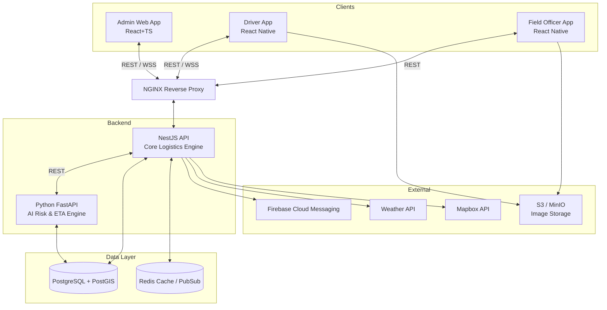
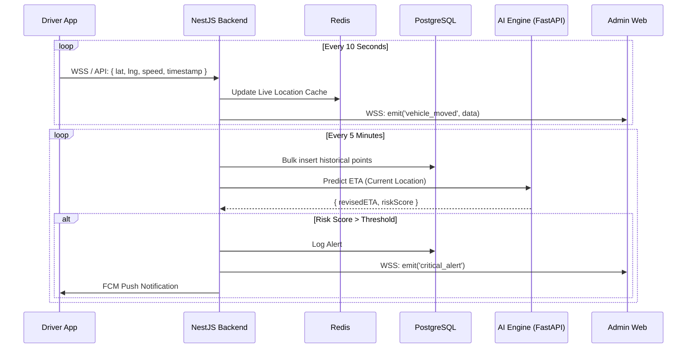
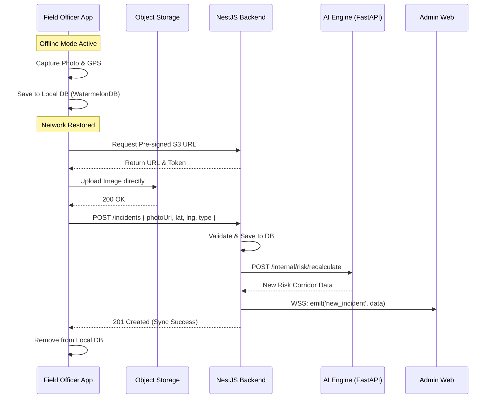

# NER-SHIELD: System Architecture Design
AI-Based Smart Logistics and Accessibility Intelligence Platform

## 1. Subsystem Architectures

### 1.1 Admin Frontend Architecture (React + TypeScript)
- **Framework**: Vite + React 18 + TypeScript.
- **State Management**: Redux Toolkit for global state; React Query for server state and caching.
- **GIS/Mapping**: Mapbox GL JS (or Leaflet) for rendering interactive fleet and incident maps.
- **API Client**: Axios configured with interceptors for JWT injection and error handling.
- **Real-time**: Socket.io-client for listening to live fleet updates and critical alerts.

### 1.2 Mobile Architecture (React Native)
- **Framework**: React Native (CLI or Expo bare workflow) + TypeScript.
- **Offline Storage**: WatermelonDB or SQLite for robust offline-first caching of incidents and routes.
- **Background Tasks**: Headless JS for periodic GPS tracking and offline sync queues.
- **Navigation**: Deep-linking to Google Maps/Mapbox for turn-by-turn, while keeping the app alive for background GPS.
- **Push Notifications**: Firebase Cloud Messaging (FCM).

### 1.3 Backend Architecture (Node.js + NestJS + TypeScript)
- **Framework**: NestJS, providing strict modularity, dependency injection, and decorators.
- **API Standard**: RESTful JSON API (`/api/v1`), Swagger/OpenAPI auto-generated documentation.
- **Database ORM**: TypeORM or Prisma for type-safe database queries.
- **Validation**: `class-validator` and `class-transformer` for strict DTO validation.

### 1.4 PostgreSQL/PostGIS Architecture
- **Core DB**: PostgreSQL for ACID compliance.
- **GIS Extension**: PostGIS for spatial data types (`Geometry`, `Geography`) to support complex location queries (e.g., finding incidents within 5km of a route).
- **Schema Management**: Controlled via strict programmatic migrations.

### 1.5 Redis Architecture
- **Caching**: Frequently accessed data like route shapes and weather conditions.
- **Live State**: Storing the latest GPS coordinates of the entire fleet to prevent overwhelming PostgreSQL.
- **Pub/Sub**: Facilitating WebSocket event broadcasting across horizontally scaled backend instances.

### 1.6 WebSocket Architecture
- **Framework**: NestJS WebSockets module (Socket.io).
- **Rooms/Namespaces**: Divided by geographical sectors or specific active shipments so clients only receive relevant updates.
- **Fallback**: Long-polling if WebSocket connections are blocked by enterprise firewalls.

### 1.7 Python AI Service Architecture
- **Framework**: FastAPI + Python.
- **Data Science Stack**: Pandas, GeoPandas, Scikit-learn, PyTorch.
- **Execution**: Runs as a separate microservice. Exposes internal REST endpoints exclusively for the NestJS backend.
- **Statelessness**: Models loaded into memory on startup; predictions are stateless to allow scaling.

### 1.8 External Integration Architecture
- **Map & Routing Services**: Mapbox Directions and Matrix APIs for calculating initial optimal routes.
- **Weather Services**: OpenWeatherMap or IMD API. Fetched server-side and cached.

### 1.9 Notification Architecture
- **Centralized Module**: A dedicated Notification service within NestJS.
- **Channels**: FCM (Mobile Push), WebSockets (Web UI), and Email/SMS (Twilio/SendGrid if required for external stakeholders).

### 1.10 File/Image Storage Architecture
- **Storage Strategy**: AWS S3 (or MinIO for self-hosted/local environments).
- **Upload Flow**: Client requests a Pre-Signed URL from NestJS -> Client uploads image directly to S3 -> Client submits incident form with the final S3 object URL to NestJS. (Saves backend bandwidth).

### 1.11 Authentication Architecture
- **Strategy**: JWT (JSON Web Tokens).
- **Implementation**: Access Tokens (short-lived, 15m) and Refresh Tokens (long-lived, HttpOnly cookie) managed via NestJS Passport module.

### 1.12 Authorization Architecture
- **Strategy**: RBAC (Role-Based Access Control) using NestJS Guards and Custom Decorators (e.g., `@Roles('ADMIN')`).
- **Granularity**: Resource-level checks where applicable (e.g., a driver can only update their *own* shipment).

### 1.13 Logging Architecture
- **Logger**: Winston or Pino generating structured JSON logs.
- **Audit Logging**: Specific critical actions (e.g., rerouting approval, user creation) explicitly logged to an `audit_logs` PostgreSQL table.

### 1.14 Monitoring Architecture
- **Metrics**: Prometheus scraping `/metrics` endpoints.
- **Dashboards**: Grafana for visualizing API latency, error rates, and system health.

### 1.15 Deployment Architecture
- **Containerization**: Docker for all services (React build, NestJS, FastAPI, DB, Redis).
- **Orchestration**: Kubernetes or Docker Compose (for MVP/single-node).
- **Reverse Proxy**: NGINX handling SSL termination and routing `/api` to NestJS, `/` to React.

---

## 2. Major Data Flows

### A. Admin → Backend
1. Admin submits a form via React (e.g., Create Shipment).
2. Axios POSTs JSON payload to `/api/v1/shipments` with Bearer JWT.
3. NestJS validates DTO. Stores shipment in PostgreSQL. Returns `201 Created`.
4. Redux/React Query invalidates shipment list cache and refetches.

### B. Driver → Backend
1. Driver accepts a shipment in the app.
2. App sends REST `PATCH /api/v1/shipments/{id}/status`.
3. NestJS updates status, creates Audit Log, and emits WebSocket event to Admin.

### C. Field Officer → Backend (Offline-First Incident Report)
1. Officer captures photo & GPS offline. Saved to local WatermelonDB.
2. When online, background sync requests S3 Pre-Signed URL.
3. App uploads photo directly to S3.
4. App POSTs incident JSON with S3 URL to NestJS.
5. NestJS saves to PostgreSQL and triggers Risk Engine.

### D. GPS → Backend
1. Mobile app fires high-frequency GPS coordinate payload.
2. NestJS receives via WebSocket or bulk REST endpoint.
3. NestJS writes coordinate to **Redis** (Live tracking cache).
4. Periodically (e.g., every 5 mins), Redis flushes coordinates to PostgreSQL for historical route playback.

### E. Weather → Backend
1. NestJS Cron Job runs every 30 mins.
2. Fetches weather for active geographical sectors from Weather API.
3. Saves current conditions to Redis.

### F. Incident → Risk Engine
1. NestJS receives a new road blockage incident.
2. NestJS makes internal HTTP request to Python AI Service: `POST /internal/risk/recalculate` with incident geometry.
3. AI Service calculates updated risk scores for surrounding road segments.

### G. Backend → AI (ETA Prediction)
1. NestJS needs an ETA for a shipment.
2. NestJS POSTs current location, weather data, and route topology to FastAPI `/predict/eta`.

### H. AI → Backend
1. FastAPI responds to NestJS with: `{"eta_minutes": 120, "confidence": 0.88}`.
2. NestJS saves this prediction to the database and alerts Dispatch if ETA delay is > 10%.

### I. Backend → WebSocket
1. Redis Pub/Sub detects a new location update or critical alert.
2. NestJS Gateway broadcasts the JSON payload to connected clients in the corresponding sector room.
3. Admin React app updates the Map marker without reloading.

### J. Backend → Notifications
1. NestJS detects a "High Risk" alert for an active route.
2. Notification Service pushes alert to FCM.
3. Driver's mobile phone displays a critical Push Notification.

---

## 3. Architecture Diagrams

### System Overview

### Real-Time GPS Tracking & Alert Flow

### Incident Reporting & Offline Sync Flow

